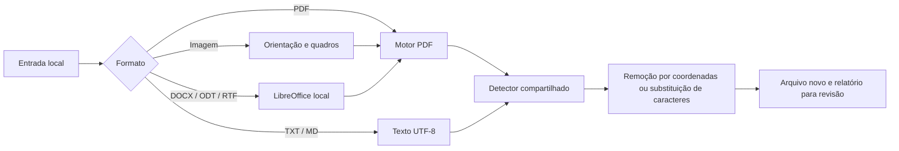

# Arquitetura e formatos do Tarja 0.3

## Fluxo

O comando `tarja` valida os argumentos e escolhe as entidades. Por padrão habilita CPF; flags acrescentam RG, CNH e título de eleitor. A API `Policy()` também assume somente CPF. `--entities` permite uma seleção exata.

`formats.censor_document()` valida entrada, extensão de saída, tamanho e ausência de sobrescrita, e despacha para o adaptador correspondente:

Os adaptadores de imagem e Office usam diretórios temporários com escopo limitado à operação. O PDF intermediário nunca é entregue como resultado: passa pelo mesmo motor de censura dos PDFs de entrada. O hash informado no relatório é sempre o do arquivo original, não o do intermediário.

## Módulos

- `models.py`: política, entidades, relatórios e erros controlados.
- `detectors.py`: padrões, intervalos, contexto, validação de CPF e pontos para conferência.
- `ocr.py`: extração, correspondência entre texto e caixas de caracteres e critérios que exigem OCR.
- `censor.py`: censura e geração de PDF estático.
- `formats/text.py`: substituição por intervalos em TXT/MD.
- `formats/images.py`: orientação EXIF, transparência, múltiplos quadros e normalização de imagem.
- `formats/office.py`: descoberta e execução do LibreOffice com perfil separado e timeout.
- `formats/__init__.py`: seleção do adaptador e política de nomes para lotes.
- `main.py`: interface de linha de comando, lote e relatório.

O motor de construção é Hatchling, com pacote explicitamente selecionado em `src/tarja`. O uv administra o ambiente e as dependências. Arquivos históricos, dados locais e resultados não entram nos artefatos de distribuição. Fontes: [estrutura de projetos uv](https://docs.astral.sh/uv/concepts/projects/layout/), [layout src](https://packaging.python.org/en/latest/discussions/src-layout-vs-flat-layout/).

## Semântica dos formatos

PDFs e imagens resultam em PDF estático. Não há modo de PDF pesquisável implementado. Os metadados, imagens e streams do original não são anexados; cada página é renderizada após a censura e colocada num documento novo.

TXT/MD usam UTF-8, aceitando BOM na entrada. O texto é tratado como texto literal, sem renderização de HTML/Markdown, execução de conteúdo ou acesso aos links. Caracteres alfanuméricos dos valores completos são substituídos por asteriscos; CPF parcial preserva os seis dígitos centrais. As mídias referenciadas pelo Markdown não são censuradas.

DOCX, ODT e RTF dependem de [conversão pelo LibreOffice](https://help.libreoffice.org/latest/en-US/text/shared/guide/start_parameters.html). A saída não é um documento editável no formato original. A renderização depende das fontes e da versão do LibreOffice. A inspeção de layout é obrigatória e aparece no relatório. A configuração do perfil temporário eleva a segurança de macros; o adaptador não é uma sandbox para arquivos hostis.

## Avisos

| Código | Significado |
| --- | --- |
| `cpf_checksum_invalid_masked` | Número com aparência de CPF e DV inválido; foi censurado mesmo assim |
| `ocr_requires_visual_review` | Reconhecimento por OCR necessita conferência |
| `ocr_cpf_expanded_to_full` | A política parcial foi ampliada para remoção completa em página OCR |
| `cpf_irregular_expanded_to_full` | A política parcial foi ampliada para remoção completa em CPF fora do padrão de 11 dígitos, como zeros perdidos ou letras de OCR |
| `unredacted_candidates_require_review` | A página tem pontos para conferência: números suspeitos que não foram censurados |
| `no_text_detected` | Página sem texto extraído; confira se está vazia |
| `office_conversion_requires_layout_review` | A conversão Office pode modificar a apresentação |
| `markdown_linked_content_not_processed` | Conteúdo externo e mídias referenciadas não foram processados |

As regiões e os pontos para conferência do relatório não contêm valores pessoais. Coordenadas PDF são relativas à página sem rotação; a rotação visual é preservada na saída. Intervalos em TXT/MD são posições de caracteres no texto decodificado, sem BOM; a substituição preserva o comprimento, então valem também na saída. Esse formato pode alimentar uma futura interface de revisão, sem alterar o núcleo.

## Critérios de detecção

A detecção prefere censurar a mais. Um valor com formato de CPF é CPF mesmo sob rótulo de RG, pois a Carteira de Identidade Nacional usa o CPF como número, ou de CNH formatada. Só a CNH usa 11 dígitos sem pontuação. Quando a CNH não está selecionada, esse número fica visível apenas se o rótulo estiver colado ao valor e não for combinado com CPF (`CPF/CNH`); mesmo assim, entra como ponto para conferência.

Os filtros de falso positivo cobrem formas que não costumam ser CPF:

- valores monetários, como `123.456.789,00` e `123,456,789.00`;
- separação parcial só com espaços, como em linhas de boleto;
- números após rótulos de telefone, celular, matrícula, conta ou `R$`, mas apenas quando o DV é inválido.

Um rótulo de CPF logo antes desativa os dois primeiros filtros. Os padrões aceitam espaços Unicode e invisíveis, traços, pontos médios e vírgulas como separadores, com no máximo uma quebra de linha, e usam quantificadores possessivos para evitar retrocesso exponencial.

No modo `auto`, o OCR também é exigido em páginas com mais de 60 segmentos de retas e curvas preenchidos, sinal de texto convertido em curvas. Retângulos de tabelas e gráficos de barras não contam. O mesmo vale para páginas com três ou mais caracteres de substituição ou de controle, sinal de fonte sem mapeamento Unicode.

## Adicionar um formato

Criar um adaptador que retorne um PDF intermediário ou um resultado textual, registrar as extensões e a extensão de saída, e chamar o detector existente. Os testes devem verificar preservação do original, remoção dos valores, conteúdo alheio preservado, limpeza de intermediários, erros e contagem de páginas. Conversores externos precisam de timeout e erros que não revelem conteúdo do documento.

Não registrar extensões apenas porque uma biblioteca as abre: sua conversão precisa ser implementada e a cobertura documentada. Planilhas, apresentações, DOC antigo e formatos com macros não foram habilitados nesta versão.
